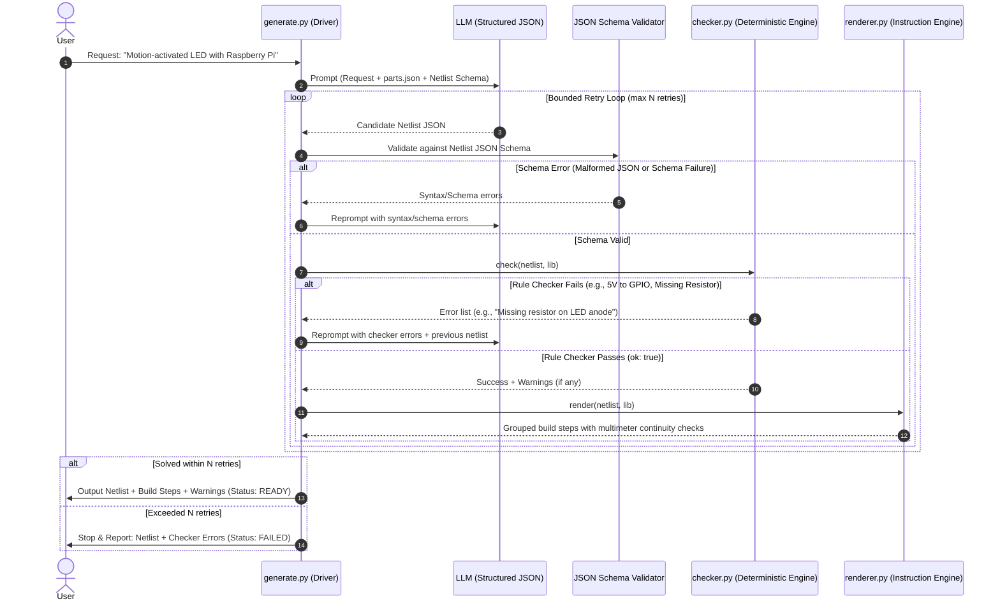
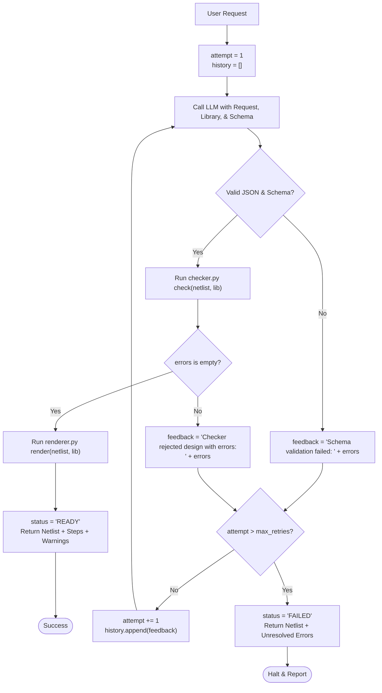

# Phase 2 Design Specification: On-Demand Netlist Generation (`generate.py`)

## 1. Executive Summary & Core Principle

In Phase 1, `buildmvp` established the fail-closed safety gate and structured datasheet provenance pipeline:
> **The model proposes, deterministic code decides.**
> Nothing the model produces reaches the user's hardware or assembly bench without passing strict, deterministic validation. Safety rules are hard physical constraints, never weakened to allow an unverified or risky design to pass.

Phase 2 builds the generative front-end for the deterministic core: **`generate.py`**.
Given a natural language user request (e.g. *"Build a motion-activated nightlight using a Raspberry Pi 4, PIR sensor, and an LED"*), `generate.py` orchestrates an LLM to generate a candidate circuit netlist, passes that netlist directly to the deterministic rule checker (`checker.py`), and executes a bounded self-correction loop when errors occur.

Nothing is marked ready or handed to the instruction renderer (`renderer.py`) until it passes all deterministic checks without blocking errors.

---

## 2. System Architecture



---

## 3. `generate.py` Specification

### 3.1 Input / Output Contract

- **Input:**
  - `request` (string): Natural language description of the circuit behavior and desired components.
  - `parts_library` (`parts.json`): Available component definitions with known pinouts, voltage levels, and absolute maximum ratings.
  - `schema` (`netlist.schema.json`): Strict JSON Schema defining valid netlist structure.
- **Output:**
  - `netlist`: The generated JSON netlist.
  - `status`: `"READY"` (passed checker) or `"FAILED"` (halted after retry limit without passing).
  - `steps`: Rendered step-by-step assembly instructions with multimeter continuity checks (only populated when `status == "READY"`).
  - `errors`: List of blocking electrical safety errors (empty when `status == "READY"`).
  - `warnings`: List of non-blocking safety warnings (e.g., conservative limits applied for unverified sensor outputs).
  - `attempts_used`: Number of generation attempts (1 to $N+1$).

### 3.2 Prompt Construction & System Prompt

The LLM is prompted with three foundational contexts:
1. **System Persona & Constraints:**
   - You are a precision physical computing and electronics engineer.
   - You must output valid JSON only, conforming exactly to the netlist schema.
   - You must satisfy all physical electrical rules:
     - All referenced parts must exist in the provided library.
     - LEDs require a current-limiting resistor on the anode net; cathode must connect to ground.
     - 5.0V sensor output pins cannot directly connect to 3.3V GPIO nets without voltage translation.
     - Relays driven from GPIO require a switching transistor and a flyback diode.
     - Transistors driven from GPIO require a series base resistor and emitter on ground.
2. **Library Context (`parts.json`):**
   - Injected directly into the prompt so the model knows exact part names, available pins, and voltage ratings.
3. **Netlist Schema:**
   - Field definitions: `name`, `parts` (instance ID $\rightarrow$ part type), `values` (e.g. resistance in ohms), `nets` (net name $\rightarrow$ list of `"<instance>.<pin>"`).

### 3.3 Structured JSON Parsing

- Model responses are enforced to return structured JSON.
- If using an API with native JSON schema constraints / structured outputs (e.g. OpenAI Response Format or Anthropic Tool Use / JSON mode), the schema is passed as the response schema.
- Before running the electrical checker, `generate.py` validates the parsed JSON against `netlist.schema.json`. Malformed responses or schema mismatches are treated as Level-1 validation errors and immediately fed back into the retry loop.

---

## 4. The Bounded Retry Loop

The retry loop is strictly bounded (default: **3 retries**, total 4 attempts).



### 4.1 Error Feedback Formatting
When `checker.py` rejects a design, `generate.py` constructs a concise, structured correction prompt:

```text
Your previous netlist was REJECTED by the deterministic electrical safety checker:

ERRORS:
1. Missing current-limiting resistor on anode net 'LED_ANODE' for LED 'led1'.
2. Current 27.7 mA exceeds GPIO rated limit of 16 mA on 'pi.GPIO17'.

PREVIOUS NETLIST:
{ ... }

CORRECTION INSTRUCTIONS:
Fix all electrical errors listed above. Ensure a resistor is placed in series between the GPIO pin and the LED anode. Recalculate resistance using Ohm's Law (R = (V_supply - V_f) / I) to ensure current remains below 16 mA.
Return ONLY the corrected JSON netlist.
```

### 4.2 Fail-Closed Guarantee
Under no circumstances does `generate.py` lower checker thresholds, ignore warnings on absolute maxima, or mark a netlist as ready if any checker error remains. If the retry cap is reached without passing, execution halts with exit code 1 and outputs the full diagnostic log.

---

## 5. Output Format

`generate.py` provides both human-readable terminal output and structured JSON (`--json`):

```json
{
  "status": "READY",
  "ok": true,
  "request": "Blink an LED from Raspberry Pi 4 GPIO17 with a 330 ohm resistor",
  "attempts_used": 1,
  "netlist": {
    "name": "blink_led",
    "parts": {
      "pi": "raspberry_pi_4",
      "led1": "led",
      "r1": "resistor"
    },
    "values": {
      "r1": 330
    },
    "nets": {
      "SIGNAL": ["pi.GPIO17", "r1.a"],
      "LED_ANODE": ["r1.b", "led1.anode"],
      "GND": ["pi.GND", "led1.cathode"]
    }
  },
  "warnings": [],
  "errors": [],
  "steps": [
    "### Power",
    "Connect pi.GND to led1.cathode. Check: multimeter continuity between pi.GND and led1.cathode should beep.",
    "### Signal",
    "Connect pi.GPIO17 to r1.a. Check: multimeter continuity between pi.GPIO17 and r1.a should beep.",
    "### Output",
    "Connect r1.b to led1.anode. Check: multimeter continuity between r1.b and led1.anode should beep.",
    "Power on. Confirm the LED lights, then power off to finish."
  ]
}
```

---

## 6. Evaluation Framework (10 Fixed Test Requests)

To evaluate `generate.py` systematically without flaky tests, Phase 2 defines an automated evaluation benchmark with **10 fixed requests** and known-good golden netlists.

### 6.1 Benchmark Suite

| # | Request Description | Target Circuit & Key Rules Tested | Expected Baseline |
| :- | :--- | :--- | :--- |
| **1** | *"Blink an LED from a Raspberry Pi 4"* | Simple LED + series resistor ($\ge 220\ \Omega$) on GPIO17; cathode to GND. Tests LED current limiting. | First-attempt pass |
| **2** | *"Add a 3.3V PIR motion sensor to light up an LED"* | PIR sensor (VCC to 5V, GND to GND, OUT to GPIO27) + LED with series resistor on GPIO17. Tests sensor and output coexistence. | First-attempt pass |
| **3** | *"Switch an external 12V automotive bulb using a 5V relay module with built-in driver"* | Relay module with `has_driver_transistor: true` and `has_flyback_diode: true` connected to Pi GPIO. Tests module-level relay rule. | First-attempt pass |
| **4** | *"Drive a bare relay coil directly from GPIO with protection"* | Bare relay coil with external NPN transistor (base resistor $\ge 1\ \text{k}\Omega$, emitter to GND) and flyback 1N4001 diode antiparallel across coil. Tests multi-part protection. | 1 retry (common: missing base resistor on attempt 1) |
| **5** | *"Wire a 5V sensor to a 3.3V Raspberry Pi"* | Model must NOT connect 5V sensor output directly to 3.3V GPIO; must reject or add voltage divider / level shifter. Tests 5V-to-3.3V fail-closed rule. | Passes with divider or halts safely |
| **6** | *"Two status LEDs (Green on GPIO22, Red on GPIO23) sharing a ground"* | Two independent resistor-LED branches sharing common ground return net. Tests pin exclusivity and net splitting. | First-attempt pass |
| **7** | *"High-current buzzer or LED requiring 50 mA switched from Pi"* | Switching transistor configuration; model must not attempt to draw 50 mA directly from 16 mA GPIO pin. Tests overcurrent prevention. | 1 retry (common: direct drive error $\rightarrow$ transistor fix) |
| **8** | *"PIR motion detector with buzzer alert via transistor switch"* | Sensor input net + transistor-switched load net. Tests multi-subsystem grouping. | First-attempt or 1 retry |
| **9** | *"RGB LED with separate red, green, and blue cathode channels"* | Common anode/cathode with individual current-limiting resistors for each channel. Tests multi-pin component values. | First-attempt pass |
| **10** | *"Overcurrent stress test: 5 LEDs connected simultaneously"* | 5 LEDs on separate GPIO pins; tests cumulative current limits and net naming discipline. | First-attempt pass |

### 6.2 Tracking Metrics
The evaluation script (`tests/test_generate_eval.py`) records:
- **First-Attempt Pass Rate (%):** Fraction of prompts that pass the deterministic checker on attempt 1 without retries.
- **Retry Convergence Rate (%):** Fraction of prompts that initially failed but successfully converged to a passing netlist within $N$ retries.
- **Average Retries Used:** Mean number of retries required across all 10 benchmarks.
- **Common Failure Modes:** Categorized breakdown of initial model errors (e.g., forgotten base resistor, incorrect resistor value, invalid pin identifier).

---

## 7. Open Decisions for User Review

The following implementation decisions require user confirmation before coding begins:

### 1. Model API Provider
- **Options:**
  - **Google Gemini API** (e.g. `gemini-2.5-flash` or `gemini-2.5-pro`): Native structured JSON mode, very fast, cost-effective for iterative retries.
  - **Anthropic Claude API** (e.g. `claude-3-7-sonnet`): High instruction adherence for electrical topologies; tool-use structured outputs.
  - **OpenAI API** (e.g. `gpt-4o` or `gpt-4o-mini`): Native JSON Schema Strict Mode (`response_format: { type: "json_schema", ... }`).
  - **Local Model / Ollama / vLLM** (e.g. `qwen2.5-coder-7b` / `llama3.1-8b`): Fully offline, zero API costs, zero data leakage; slightly lower zero-shot electrical topology accuracy.
- *Recommendation:* Abstract the client via a simple provider adapter interface (`LLMClient`), with default support for Google Gemini and OpenAI-compatible endpoints.

### 2. API Key Management
- **Security Invariant:** Never commit API keys, secrets, or `.env` files to the repository.
- **Options:**
  - Standard environment variable: `BUILDMVP_API_KEY` or provider-specific (`GEMINI_API_KEY`, `OPENAI_API_KEY`, `ANTHROPIC_API_KEY`).
  - Command-line argument: `--api-key-env VAR_NAME` (reads from named environment variable).
- *Recommendation:* Read from `BUILDMVP_API_KEY` (or standard provider environment variables). Add `.env*` to `.gitignore`. If no key is set and no mock is provided, exit with a clean diagnostic error explaining how to set the environment variable.

### 3. Generated Netlist Persistence
- **Options:**
  - **Ephemeral (Default):** Output directly to `stdout` (or `--json`), with an optional `--save <path>` or `--out <path>` flag.
  - **Automatic Directory Logging:** Automatically write every valid build to `generated/<timestamp>_<name>.json` and failed attempts to `generated/.failed/`.
- *Recommendation:* Ephemeral by default for clean CLI piping, with `--save <path>` for explicit storage, and `--save-dir generated/` enabled during evaluation runs.

### 4. Datasheet Lookup Integration & Unverified Parts Blocking
- **Context from Phase 1:** If an MCU GPIO pin or power rail has unverified limits, `checker.py` fails closed.
- **Decision:** When the LLM proposes a component not in the seed `parts.json`:
  - **Option A (Strict Fail-Closed Blocking):** Halt immediately if a part is unknown or lacks a verified datasheet in the local cache. Generation cannot proceed without a human or automated datasheet ingestion run.
  - **Option B (On-Demand Fetch Loop):** Intercept unknown parts during the generation loop, invoke `datasheet_ingest.py` to extract specs from a local PDF cache, validate against `datasheet_extraction.schema.json`, and if valid, register the part before running the checker.
- *Recommendation:* Start Phase 2 with **Option A** (strict fail-closed against the local parts library/cache). Then wire Option B once the standalone generation retry loop is verified and tested.
